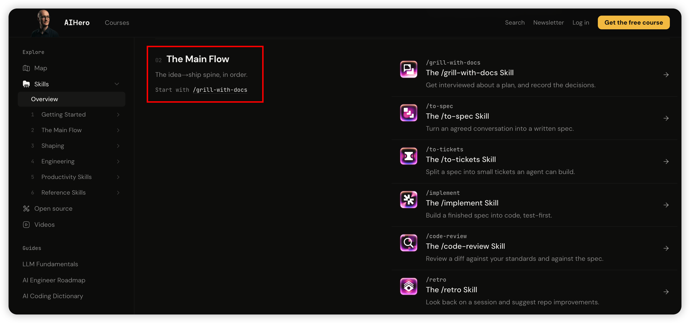

<p align="center"></p>

<h1 align="center">Matt Pocock 开发工作流</h1>

<p align="center">Matt Pocock Mainflow</p>

<p align="center">
  <strong>把 Matt Pocock 的六步开发工作流 The Main Flow（Skills 仓库获 30 万+ GitHub Stars）串成一个入口，给开发流程加上「自动挡」：你只管说要做什么，Agent 会根据实际任务和当前进度判断该走哪一步，并调用对应的 Skill，让这套工作流更容易上手。</strong>
</p>

<p align="center">
  <a href="#why">The Main Flow 解决什么问题</a> ·
  <a href="#workflow">一个命令走流程</a> ·
  <a href="#quickstart">快速上手</a> ·
  <a href="#project-files">项目文件</a>
</p>

---

<a id="why"></a>

## 💡 The Main Flow 解决什么问题？

把一个粗略的功能想法交给 Agent，它可能很快就写出代码，但需求边界和验收条件往往还没谈清。Matt Pocock 的 **The Main Flow** 给出了从想法到交付的路线。先把关键决定写成规格，再拆成可以独立验收的工单。实现后，用同一份规格检查代码有没有做对，最后复盘哪里可以改进。 [The Main Flow 原文](https://www.aihero.dev/skills)

**需求讨论 → 写规格 → 拆工单 → 实现 → 代码审查 → 复盘**

`grill-with-docs` → `to-spec` → `to-tickets` → `implement` → `code-review` → `retro`

[](https://www.aihero.dev/skills)

<a id="workflow"></a>

## 🎯 只需同一个命令就能自动走完全部流程

**只用 `/matt-mainflow`，Agent 就会根据任务和进度自动判断该走哪一步，并引导你推进到收尾。**

| 场景 | 单独使用原版 Skills 时怎么做 | 用 `/matt-mainflow` 时怎么做 |
|---|---|---|
| 登录跳转有个小问题，复现和验收都清楚 | 自己判断可以跳过写规格和拆工单，安排修复、验证，再手动发起审查。 | 描述问题和验收条件。Agent 判断可以走短路线，直接修复、验证和审查。 |
| 想做一个功能，行为和边界还没说清 | 手动触发 `/grill-with-docs`，谈清后调用 `/to-spec`，再判断要不要拆工单。 | 描述想法。Agent 先和你谈清关键决定，再写规格供确认。一次能做完时，确认后进入实现。 |
| 任务要分几批做，或者要交给另一个会话接手 | 在规格确认后手动调用 `/to-tickets`，再按依赖选择工单、触发实现。 | 交代目标和已有规格。Agent 判断何时需要拆工单，经你确认后按依赖分批推进。 |
| 手上已经有规格或工单 | 自己检查现有文件是否适用，判断该拆工单、实现还是审查，再触发对应的 Skill。 | 给出已有规格或工单。Agent 核对是否适用，从最早还有工作的阶段接入。 |
| 做到一半，拿不准下一步该用哪个 Skill | 翻看规格、工单和已做的改动，自己判断下一步并手动触发。 | 输入 `/matt-mainflow 查看进度`。Agent 核对记录与现有产物，告诉你当前阶段和下一步。 |
| 开发做完了，工单和验收记录还散在临时目录里 | 自己核对验收和审查是否完成，整理要保留的资料，再检查哪些临时文件可以删。 | 输入 `/matt-mainflow 收尾`。Agent 判断是否达到收尾条件，整理要保留的成果。正式成果提交后，它会列出清理清单，等你确认再清理本任务的临时文件。 |

代码审查同时看项目规范和已确认的需求。有返工、漏检或交接问题时，可以复盘哪一步值得改进。完整的路线选择见 [Skill 说明](SKILL.md#选择路线)。

---

<a id="quickstart"></a>

## 🚀 快速上手

### 安装

把下面这句话发给你的 Agent。

```text
请从 https://github.com/vincent4j/matt-mainflow 安装 matt-mainflow 到你的 Skills 目录，并按仓库 SKILL.md 中的阶段依赖表安装所需的 Matt Pocock Skills。
```

源码安装完成后，打开新会话，确认能找到 `matt-mainflow`，且 Agent 能读取当前阶段及所需依赖的指引。

### 开始一个任务

在开发项目的技能菜单中搜索 `matt-mainflow` 或 **Matt Pocock Mainflow**，选中后描述任务。支持斜杠菜单的 Agent 可以这样输入。

```text
/matt-mainflow 登录成功后应返回登录前访问的页面。先和我确认验收条件，再开始修改。
```

| 你想做什么 | 直接告诉 Agent |
|---|---|
| 看看做到哪了 | 查看进度 |
| 推进刚展示的待确认步骤 | 确认该动作，例如「确认按这份草案写入工单」 |
| 改一条已经讨论过的需求 | 返回写规格，我想修改验收条件 |
| 留到下次处理 | 暂停。下次在同一个项目里调用 `matt-mainflow`，说「继续」查看恢复点。如果还有待你确认的动作，按新显示的卡片答复。 |
| 验收和审查完成，准备结束 | 收尾 |

首次在项目里推进任务时，Agent 会自动检查配置。缺少配置时，它会读取 `setup-matt-pocock-skills` 指引，展示本地初始化草案，经你确认后再 [启用项目](SKILL.md#项目启用)。

---

<a id="project-files"></a>

## 📁 项目里会新增什么？

| 文件或目录 | 用来做什么 |
|---|---|
| `.scratch/matt-mainflow/<任务名>/state.md` | 记录当前阶段、已确认的范围和下一步，供新会话续接。 |
| `.scratch/<任务名>/issues/` | 需要拆分时，存放确认后的工单，每张一个 Markdown 文件。 |

书面规格沿用项目的本地约定，缺少约定时存为 `.scratch/<任务名>/spec.md`。收尾后，正式成果已提交且你确认过清单时，可以回复「清理本任务」移除对应的临时文件。

[场景验收清单](references/validation.md)

## 离线安装包

把 ZIP 保存到本机后，可以导入 WorkBuddy。支持从本地目录加载 Skills 的 Agent 也可以接收 ZIP 和这条指令。

```text
请从附件 ZIP 解出 matt-mainflow 目录，完整安装到你配置的 Skills 目录。
请保留 SKILL.md 和整个 references/，并从本地文件核对安装和依赖。全程使用这个附件安装。
```

安装后在新会话里调用 `matt-mainflow`。初始化指引、六个阶段及其依赖和 MIT 许可均随包提供，安装和读取这些指引无需访问 GitHub。

维护者可在仓库根目录运行 `python3 packaging/build.py`，生成 `dist/matt-mainflow-offline-<版本>.zip`，版本取自 `manifest.json`。构建时获取并校验锁定版本的上游文件，也可加 `--upstream-archive <归档路径>` 断网构建。ZIP 只存放在本地。
